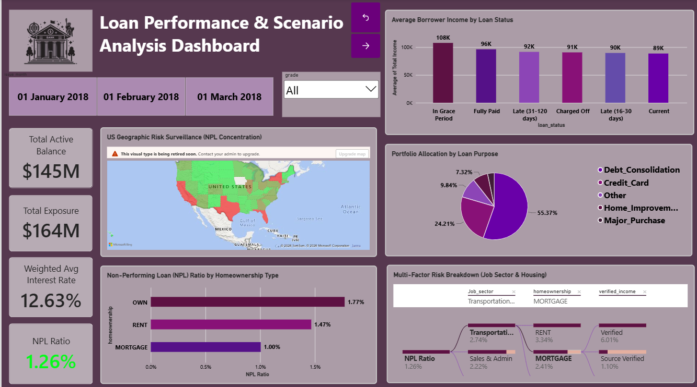
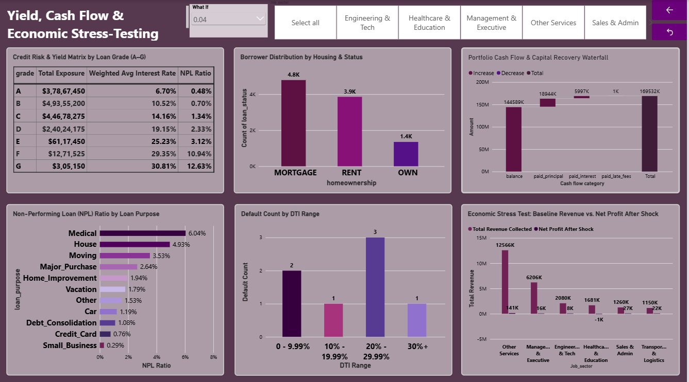

# Loan-Default-Analysis
Power BI Dashboard for analyzing borrower risk, loan defaults and portfolio profitability.

# Hi there, I'm Pratiksha More 👋

🎓 **MSc Applied Statistics & Data Analytics Student** | 📊 **Data Analytics & Power BI Enthusiast**

📍 **Mumbai, India**

### 🌟 About Me

* 🎓 **Education:** Pursuing **MSc in Applied Statistics and Data Analytics** | **BSc in Statistics** (CGPA: 9.95 / 10 from D. G. Ruparel College).

* 💡 **Core Interests:** Data Modeling, Business Intelligence, Statistical Inference, Exploratory Data Analysis (EDA), and Risk Analytics.

* 🎯 **Goal:** Eager to leverage analytical problem-solving and data visualization skills to drive data-driven decision-making in dynamic analytical roles.

* 🛠️ **Current Focus:** Building interactive Power BI dashboards, DAX , modeling, and practical statistical analysis.

### 🛠️ Technical Skills

| Domain | Tools & Technologies | 
| ----- | ----- | 
| **Statistical Analysis** | Hypothesis Testing, Regression Analysis, EDA, Probability Theory | 
| **Data Visualization & BI** | Power BI, DAX, Data Modeling, Dashboard Design | 
| **Programming & Data Tools** | R Software, Python (Basics), Advanced MS Excel (Pivot Tables, Lookups) | 

### 📌 Featured Projects

#### 💳 Loan Default & Borrower Risk Analysis

*An interactive Power BI dashboard designed to evaluate lender portfolio health, borrower risk profiles, and financial stress testing using LendingClub data.*

* 📌 **Risk:** Segmented Debt-to-Income (DTI) ratios, homeownership status, income tiers, and loan amounts to isolate high-default borrower cohorts.

* 📍 **Delinquencies:** Tracked multi-dimensional overdue loans (NPL ratios) across geographical regions, credit grades, and loan categories.

* 💰 **Profitability:** Evaluated lender cash flow recovery streams across principal, interest, and late fee collections.

* 📈 **Simulation:** Built an interactive "What-If" DAX parameter model to stress-test portfolio exposure under varying default shocks.

**🔍 Key Analytical Findings:**

* **DTI Risk Threshold:** Borrower default rate spikes significantly in the **20% – 29.99% DTI range**, establishing 20% DTI as a critical underwriting threshold to filter high-risk applicants.

* **Mortgaged vs. Owned Homes:** Applicants with mortgaged homes showed lower unpaid loan (NPL) rates than outright homeowners, validating why the bank favors mortgaged borrowers.

* **4% Loss Tipping Point:** Simulation proved that a default spike above 4% wipes out all interest income, causing total net financial losses.

* **Proactive Screening:** Tightening initial approval criteria (e.g., establishing a 20% DTI cap) is far more profitable than post-default debt collection.

* **Tech Stack:** Power BI | DAX | Data Modeling | Excel

  ## Dashboard Preview

### 📜 Certifications & Workshops

* **Power BI - Data Analysis and Visualization** – D. G. Ruparel College

* **Workshop on R Software** – D. G. Ruparel College

### 🤝 Connect with Me

* 📧 **Email:** [morepratiksha2309@gmail.com](mailto:morepratiksha2309@gmail.com)

* 💼 **LinkedIn:** [https://www.linkedin.com/in/pratiksha-more-8664a9424]

* 🖥️ **GitHub:** [https://github.com/pratiksham23]

⭐️ *Thank you for visiting my profile! Feel free to explore my repositories.*
